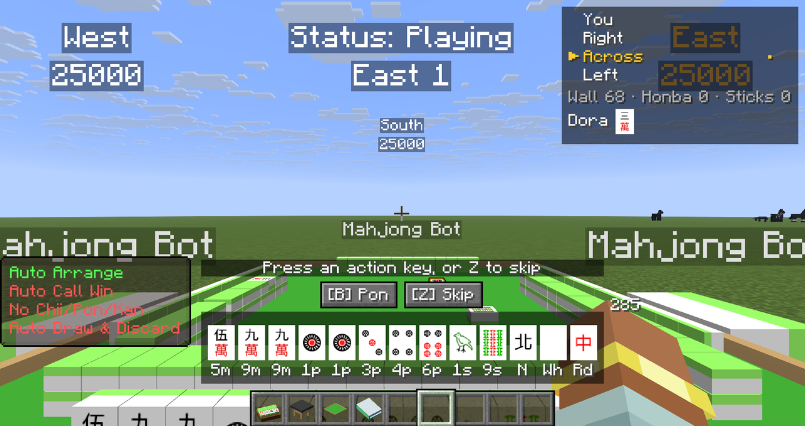
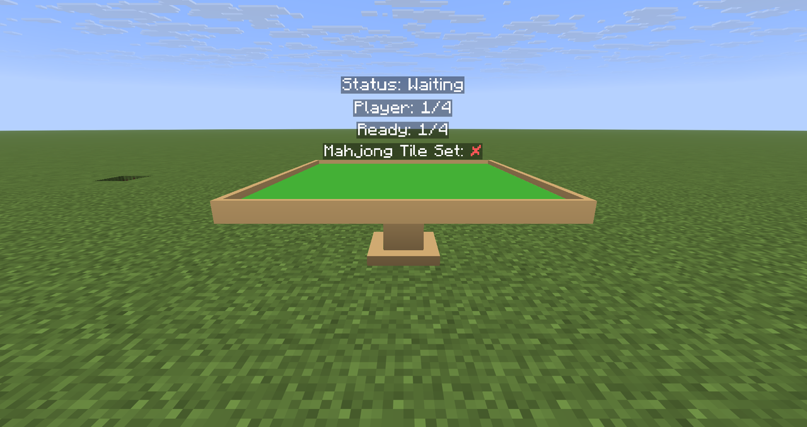
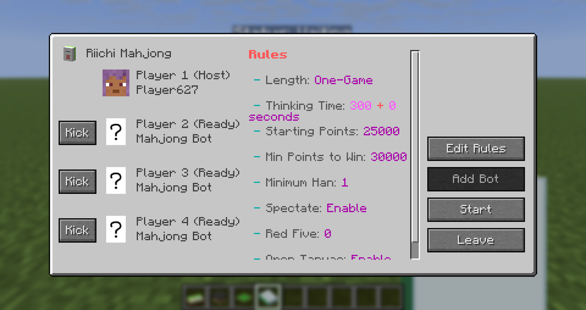
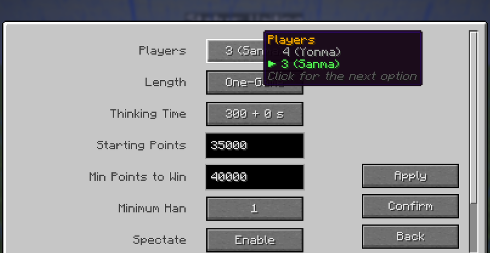
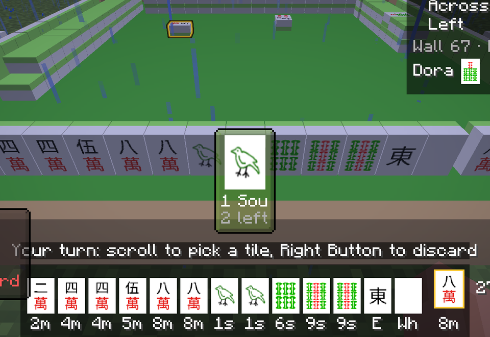
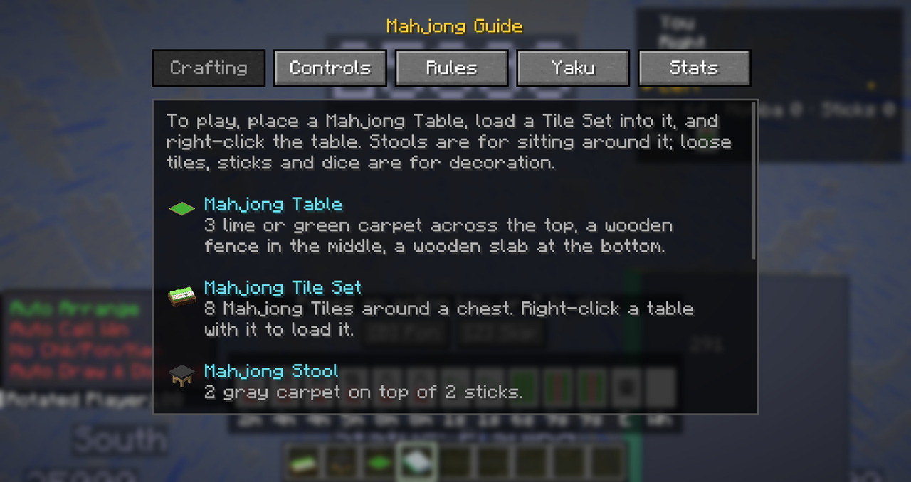
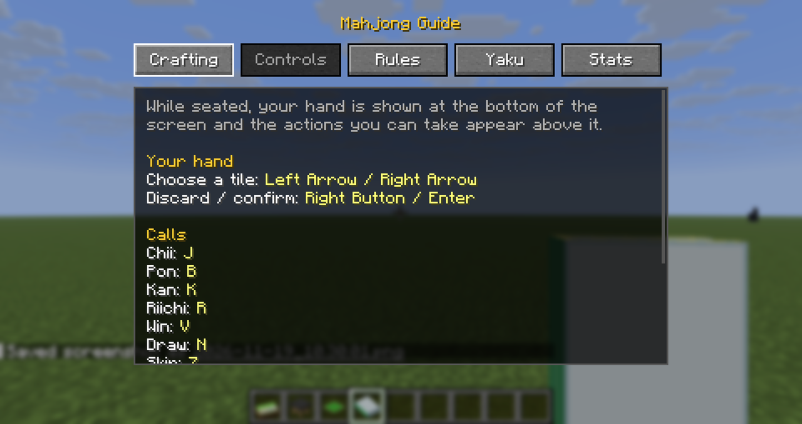

# MahjongCraft

A Fabric mod for Minecraft that lets you play Japanese (Riichi) Mahjong in game, alone against bots or with friends in multiplayer.



> **This is a fork.** MahjongCraft was created by **[doublemoon1119](https://github.com/doublemoon1119)**. The original project lives at **[doublemoon1119/MahjongCraft](https://github.com/doublemoon1119/MahjongCraft)**, and all credit for the mod, its game engine, models and textures goes there.
>
> This fork ([Aischii/MahjongCraft](https://github.com/Aischii/MahjongCraft)) ports the mod to **Minecraft 26.3**, fixes a server crash with C2ME and similar mods ([upstream issue #21](https://github.com/doublemoon1119/MahjongCraft/issues/21)), and adds an in-game HUD, key controls, survival crafting, a Mahjong Guide, advancements and stats.

**Contents:** [Install](#installing) · [Getting started](#getting-started) · [3-player (Sanma)](#3-player-sanma) · [Controls](#controls) · [The HUD](#the-hud) · [Crafting](#crafting) · [Mahjong Guide](#mahjong-guide) · [Stats](#stats) · [Advancements](#advancements) · [For server owners](#for-server-owners) · [Building from source](#building-from-source) · [Credits](#credits)

## Requirements

| | Version |
|---|---|
| Minecraft | 26.3 |
| Java | 25 |
| [Fabric Loader](https://fabricmc.net/use/) | 0.20.1 or newer |

## Dependencies
<div>
    <a href="https://www.curseforge.com/minecraft/mc-mods/fabric-api"></a>
    <a href="https://www.curseforge.com/minecraft/mc-mods/fabric-language-kotlin"></a>
</div>

- [Fabric API](https://www.curseforge.com/minecraft/mc-mods/fabric-api)
- [Fabric Language Kotlin](https://www.curseforge.com/minecraft/mc-mods/fabric-language-kotlin)
- [Cloth Config API (Fabric)](https://www.curseforge.com/minecraft/mc-mods/cloth-config)
- [Mod Menu](https://www.curseforge.com/minecraft/mc-mods/modmenu) (Optional)

## Installing

1. Install Fabric Loader for Minecraft 26.3.
2. Download the latest `mahjongcraft-mc26.3-….jar` from [Releases](https://github.com/Aischii/MahjongCraft/releases/latest). Each release lists the exact versions it needs; what changed is in the [changelog](CHANGELOG.md).
3. Put these jars in your `mods` folder: MahjongCraft, Fabric API, Fabric Language Kotlin and Cloth Config. Mod Menu is optional.
4. Start the game. On a server, the server and every player need the mod.

## Getting started

1. **Craft a Mahjong Table and place it.** It takes up a 3×3 area, so leave room around it.
2. **Load a Mahjong Tile Set.** Right-click the table while holding a Tile Set. The label above the table shows ✔ once it is loaded. To take the set back out, sneak and right-click the table with an empty hand.
3. **Right-click the table.** The waiting room opens. Click **Join**; the first player becomes the host.
4. **Fill the seats.** Friends right-click the same table and join, or the host clicks **Add Bot** for each empty seat.
5. **Set the rules (optional).** The host clicks **Edit Rules** to change the game length, thinking time, starting points and more. Hover any rule for an explanation.
6. **Ready up and start.** Everyone clicks **Ready**, then the host clicks **Start**. Seats and hands are set up automatically.

| The table, waiting for players | The waiting room, with three bots |
|---|---|
|  |  |

New to Riichi Mahjong? Craft a **Mahjong Guide** (a book and a tile): its Rules tab explains the basics in a few short paragraphs.

## 3-player (Sanma)

Any table can be a 3-player table: the host sets **Players** to **3** in **Edit Rules**. The waiting room then has three seats, and one side of the table stays empty.



- **108 tiles:** 2m–8m are left out. With a 1m dora indicator, the dora is 9m.
- **No Chii.** Pon, Kan, Riichi and wins work as usual.
- **Kita:** when you hold a North on your turn, press **X** to set it aside. It counts as one dora if you win, and you draw a replacement tile.
- **Tsumo loss:** a Tsumo is paid only by the two other players, as in Mahjong Soul and Tenhou.
- **Points:** 35,000 to start and 40,000 to win by default (switching Players moves the defaults; you can still edit them).
- Each wind has three hands (East 1–3), and the no-tenpai penalty is 2,000 points instead of 3,000.

## Controls

While you are seated, your hand is shown along the bottom of the screen and the actions you can take appear as buttons above it, each labelled with its key. You never need to aim at tiles on the table.

| Action | Default key |
|---|---|
| Choose a tile | Mouse wheel, or ← / → |
| Discard the chosen tile, or confirm | Right-click (Use), or Enter |
| Chii | J |
| Pon | B |
| Kan | K |
| Kita (3-player: set a North aside) | X |
| Riichi | R |
| Win (Tsumo / Ron) | V |
| Abortive draw (Kyuushu Kyuuhai) | N |
| Skip / pass | Z |

When an action can be done more than one way (for example two different Chii pairs), press its key again to cycle through them, then confirm.

| Other action | Default key |
|---|---|
| Open the mod config | ; |
| Move the HUD | unbound |
| Yaku overview | unbound |

Every key can be changed under **Options → Controls → Key Binds → MahjongCraft**, and the Guide's Controls tab always shows your current keys.

## The HUD

**Your hand (bottom of the screen).** Each tile has a short label underneath:

| Label | Meaning |
|---|---|
| `1m`–`9m` | Man (characters) |
| `1p`–`9p` | Pin (circles) |
| `1s`–`9s` | Sou (bamboo) |
| `E` `S` `W` `N` | East, South, West and North winds |
| `Wh` `Gr` `Rd` | White, Green and Red dragons |

- Red fives have a red label.
- The tile you just drew sits slightly apart from the rest of your hand.
- The chosen tile is raised and outlined in gold. Tiles you may not discard right now are greyed out.
- A hint line says what you can do, and the number beside your hand is your remaining thinking time.

**Table panel (top right).**

- Players by position: You, Right, Across and Left. A gold ▶ marks whose turn it is, a red **R** marks anyone in riichi, and a dot marks who discarded last.
- Tiles left in the wall, honba and riichi sticks.
- The dora indicator tiles.
- Your waits: the tiles that would complete your hand, shown when you are one tile away (tenpai).

**On the table**, the most recent discard glows gold until someone claims it or the next tile is thrown. Look at any tile to see its name and how many of it you haven't seen yet:



## Crafting

| Item | Recipe | Makes |
|---|---|---|
| Mahjong Table | 3 lime or green carpet across the top, a wooden fence in the middle, a wooden slab at the bottom | 1 |
| Mahjong Tile Set | 8 Mahjong Tiles around a chest | 1 |
| Mahjong Guide | a book and a Mahjong Tile (shapeless) | 1 |
| Mahjong Stool | 2 gray carpet on top of 2 sticks | 1 |
| Mahjong Tile | 6 white concrete beside 3 lime or green concrete (two columns of white, one of green) | 16 |
| Mahjong Scoring Stick | 1 red or black dye above 3 white concrete | 6 |
| Dice | white concrete, red dye and black dye (shapeless) | 2 |

Recipes appear in your recipe book as soon as you pick up one of their ingredients.

To play you need a table with a Tile Set loaded; the tiles, sticks and dice on the table are spawned for each game. A loaded set stays in the table and drops when the table is broken. Creative-mode players can start without one.

The loose tiles, sticks and dice are for decoration. Right-click a tile or stick to change which one it is, and sneak + right-click a block to place it.

**Finding items without crafting:** wandering traders sometimes sell a Tile Set, dice or a Mahjong Guide for emeralds, and village house chests sometimes hold dice, scoring sticks or a Guide.

## Mahjong Guide

Right-click with the Mahjong Guide to open it. It has five tabs:

- **Crafting:** every recipe in the mod.
- **Controls:** your current key bindings, so it stays right if you change them.
- **Rules:** a short how-to-play: starting a game, the goal, turns, calls, riichi, winning and furiten.
- **Yaku:** what yaku are, with a button to the full Yaku Overview.
- **Stats:** your own mahjong record in this world.

| Crafting tab | Controls tab |
|---|---|
|  |  |

## Stats

Each world (or server) keeps a mahjong record for every player. Bots are not recorded.

- Games played and how often you finished first.
- Hands played, hands won and how often you dealt into someone's Ron.
- How many times you declared riichi.
- Your three most-won yaku.
- Your last 10 games, with placement and final points.

See your own record in the Guide's Stats tab or with `/mahjong stats`, and anyone else's with `/mahjong stats <player>`.

## Advancements

The **MahjongCraft** advancement tab has six goals: craft a table, play your first hand, declare riichi, win a hand, win with a yakuman (hidden until you get it) and finish first in a full game.

## For server owners

- Every player needs the mod; it adds blocks, items and screens.
- `/gamerule mahjongcraft:require_tile_set false` lets any table start without a loaded Tile Set.
- Stats are saved with the world in `data/mahjongcraft/stats.dat`.
- `/mahjong stats [player]` can be used by anyone.

## Building from source

You need JDK 21 or newer to run Gradle; the build downloads Java 25 for itself.

```sh
git clone https://github.com/Aischii/MahjongCraft.git
cd MahjongCraft
./gradlew build      # the mod jar is written to build/libs/
./gradlew test       # unit tests
./gradlew runClient  # start a development client
```

## Credits

- **[doublemoon1119](https://github.com/doublemoon1119)**: original author of MahjongCraft, including the Riichi game engine, bots, models and textures. Original project: [doublemoon1119/MahjongCraft](https://github.com/doublemoon1119/MahjongCraft).
- [mahjong4j](https://github.com/mahjong4j/mahjong4j), used for hand evaluation, and [LibGui](https://github.com/CottonMC/LibGui), used for the screens.
- Licensed under the MIT License; see [LICENSE](LICENSE).

## Support
Please report any issues to [the issue tracker](https://github.com/doublemoon1119/MahjongCraft/issues) on Github.

我是臺灣人，除了英文以外你也可用中文發表 [問題](https://github.com/doublemoon1119/MahjongCraft/issues) 或留言
